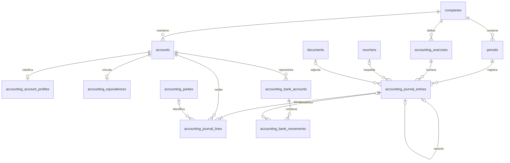

# Etapa 1 — núcleo contable VIG.IA SAS

## Estado

Núcleo desarrollado y probado con PostgreSQL 17 real y navegador. La activación en el Supabase usado por Vercel y la aceptación con una sesión de producción están pendientes por falta de acceso administrativo. La aplicación distingue ese estado: no simula un núcleo activo si faltan tablas. No se avanzó a automatizar compras, ventas, bancos, impuestos ni estados contables.

El diagnóstico previo está en [DIAGNOSTICO.md](DIAGNOSTICO.md). Se conservan empresas, plan importado, comprobantes, archivos, calendario, libro operativo y auditoría Xubio existentes. No se borró, trasladó ni contabilizó información real. Los eventos del libro anterior continúan en su circuito; incorporarlos al nuevo Diario requiere un procedimiento revisado posterior para evitar duplicaciones. La auditoría Xubio anterior conserva su alcance: todavía no compara/exporta los asientos del nuevo núcleo ni aplica automáticamente las nuevas equivalencias.

## Funcionalidades

- Ejercicios con fechas expresas, control de superposición, cierre/reapertura motivada. Cerrar exige cerrar los períodos existentes; no genera automáticamente asientos de cierre, ajuste por inflación o aperturas.
- Plan existente reutilizado, sin crear otro. Propiedades: rubro, subrubro, naturaleza, imputabilidad y equivalencia con código Xubio. Nivel derivado de la jerarquía actual. Cuentas con hijas no reciben imputaciones. Cuentas apropiadas para seguridad se sugieren para revisión, sin agregarlas ni duplicarlas.
- Diario manual: fecha, número por ejercicio, concepto, cuenta por línea, Debe/Haber, comprobante y documento. Puede subirse un respaldo y seleccionarse para vincularlo. Confirmación transaccional, cuentas activas y propias, límites del ejercicio/período, importes exactos y balance positivo.
- Clave de origen única por empresa, huella SHA-256 canónica, reintentos idempotentes y advertencia de posible duplicado económico. La excepción confirmada queda registrada. El criterio de posible duplicado usa fecha/líneas normalizadas: no demuestra identidad documental entre operaciones agrupadas de otra forma.
- Asientos confirmados sin actualización ni eliminación. Reversión con fecha y motivo, referencia única al original y líneas invertidas. Incluso el rol de mantenimiento encuentra restricciones de inmutabilidad y balance. Un original cerrado puede revertirse en un período posterior abierto con fecha válida; el original permanece.
- Mayor y sumas/saldos usan el mismo motor y solamente líneas confirmadas. Arrastre anterior dentro del ejercicio, saldo según naturaleza y rango mensual, trimestre calendario o ejercicio completo. Exportación CSV de sumas/saldos, observaciones por naturaleza, falta de rubro y ausencia de movimientos. Las agrupadoras no vuelven a sumar las hijas.
- Menú con Dashboard, Plan, Diario, Mayor, Sumas y saldos, Compras, Ventas, Bancos, Impuestos, Auditoría Xubio, Estados contables y Configuración. Las funciones anteriores siguen accesibles; las integraciones futuras muestran «Pendiente».

## Estructura relacional

Se reutilizan `organizations`, `organization_members`/`auth.users`, `companies`, `periods`, `accounts`, `vouchers`, `documents`, `imports` y `audit_events`.

| Tabla nueva | Relación y propósito |
|---|---|
| accounting_change_history | Snapshots inmutables antes/después, actor y fecha, para el núcleo y cambios del plan; complementa la bitácora existente. |
| accounting_exercises | Ejercicio por empresa, fechas y estado. |
| accounting_account_profiles | Propiedades 1:1 de una cuenta existente; no duplica código/nombre/jerarquía. |
| accounting_equivalences | Cuenta propia y código Xubio, únicos por empresa/sistema. Configuración preparada para integración posterior. |
| accounting_journal_entries | Cabecera inmutable; ejercicio, período, correlativo, fuente, moneda, autor, comprobante, documento y reversión. |
| accounting_journal_lines | Líneas UUID, posición, cuenta, contraparte opcional, Debe/Haber numeric exactos. |
| accounting_parties | Un CUIT por empresa con roles cliente/proveedor; una misma persona puede tener ambos roles sin duplicarse. Maestro preparado, sin módulo de gestión nuevo en esta etapa. |
| accounting_voucher_parties | Vincula un comprobante existente con su contraparte normalizada. |
| accounting_bank_accounts | Banco/cuenta/moneda vinculados al plan. Maestro preparado para etapa bancaria. |
| accounting_bank_movements | Movimiento con fuente única, respaldo y asiento vinculado; preparación de etapa bancaria, sin carga automática habilitada. |

Las claves compuestas impiden referencias entre empresas/organizaciones. Todas las tablas tienen UUID y RLS de lectura; las escrituras del núcleo son por RPC autorizadas. Se agregan índices únicos compuestos sobre documentos y comprobantes para las referencias nuevas, sin alterar sus filas. La bitácora existente registra actor y operaciones de tablas nuevas. `post_accounting_entry` confirma; `reverse_accounting_entry` revierte; las funciones privadas no están expuestas al rol autenticado. Numeración y escrituras se serializan por empresa dentro de la transacción.

## Cinco operaciones verificadas

Operaciones íntegramente ficticias, aisladas de VIG.IA. La usuaria confirmó que capital y gasto administrativo pasan por banco. IVA 21% usado solo como dato ilustrativo de prueba; estos resultados no constituyen una liquidación fiscal real.

| Asiento | Debe | Haber |
|---|---|---|
| 1 Aporte | Banco 5.000.000 | Capital integrado 5.000.000 |
| 2 Equipamiento | Equipamiento 1.000.000 + IVA CF 210.000 | Banco 1.210.000 |
| 3 Servicios a cobrar | Clientes 2.420.000 | Servicios 2.000.000 + IVA DF 420.000 |
| 4 Cobro parcial | Banco 1.000.000 | Clientes 1.000.000 |
| 5 Gasto pagado | Gasto administrativo 300.000 + IVA CF 63.000 | Banco 363.000 |

| Resultado | Importe ARS |
|---|---:|
| Asientos / líneas | 5 / 13 |
| Total Debe = total Haber | 9.993.000 |
| Saldos deudores = saldos acreedores | 7.420.000 |
| Banco | 4.427.000 deudor |
| Clientes | 1.420.000 deudor |
| Proveedores | 0; las compras/gastos de esta prueba se pagaron directamente |
| Equipamiento | 1.000.000 deudor |
| IVA crédito fiscal | 273.000 deudor |
| IVA débito fiscal | 420.000 acreedor |
| Capital | 5.000.000 acreedor |
| Servicios | 2.000.000 acreedor |
| Gasto administrativo | 300.000 deudor |

Banco en el Mayor: 5.000.000 → 3.790.000 → 4.790.000 → 4.427.000. Revertir el asiento 5 agrega el 6, conserva el 5 y deja banco 4.790.000, sin borrar líneas anteriores.

## Cómo usarlo

1. Empresa → Núcleo contable/Dashboard → Configurar ejercicio. Ingresar nombre, inicio y cierre reales. Abrir el período mediante el flujo de cierre existente.
2. Plan de cuentas: importar o editar como antes. «Propiedades» configura naturaleza/rubros/imputabilidad/equivalencia. Las cuentas importadas se reutilizan; no volver a cargarlas cada mes.
3. Libro Diario → Nuevo asiento. Seleccionar fecha y cuentas imputables, cargar Debe/Haber con coma decimal y vincular respaldos si corresponde. «Confirmar asiento» persiste todo o falla completo. «Ver asiento» consulta el registro. «Revertir» crea el contrasiento, con motivo y fecha válida.
4. Libro Mayor: seleccionar ejercicio, alcance y cuenta; consultar inicial, cada movimiento y saldo final. El signo se expresa según la naturaleza configurada.
5. Balance de sumas y saldos: elegir mes/trimestre/ejercicio, revisar totales y advertencias; descargar CSV. Una coincidencia aritmética no acredita documentación completa ni cierre legal.
6. Dashboard: revisar ejercicios y acceso a libros. Cierre/reapertura exige motivo; no traslada saldos entre ejercicios automáticamente. Las aperturas reales requieren asientos revisados.
7. Compras/ventas/calendario/documentación y las herramientas anteriores siguen funcionando como antes. Bancos, Impuestos y Estados contables identifican la integración nueva como pendiente. No duplicar automáticamente esos movimientos en este Diario.

## Pruebas y límites

Registro final: 107 pruebas unitarias, nueve recorridos únicos Chromium y las pruebas PostgreSQL/concurrencia aprobadas, además de lint, tipos y builds. El detalle está en TESTING.md y TASKS.md. Comandos: `npm test`, `npm run lint`, `npm run typecheck`, `npm run build`; `npm run test:db` requiere un clúster PostgreSQL local descartable explícito. Prueba SQL: migraciones originales + nuevas, reglas anteriores, cinco operaciones, restricciones físicas, RLS, roles, fechas/cierres, cuentas, duplicados, rollback, reversión y dos conexiones concurrentes. Prueba navegador: ejercicio real en el adaptador de desarrollo, cinco altas, persistencia/reapertura, comparación de libros, CSV, reversión, propiedades del plan y migración ausente; regresiones de plan permanente/inicio/auditoría.

Pendientes: activación y prueba de aceptación con Supabase/Auth/PostgREST/Storage reales; apertura y revisión contable de VIG.IA; integración del nuevo Diario a los módulos previos y a Auditoría Xubio; gestión de maestros de contrapartes/bancos; generación de asientos automáticos y estados contables. El código no se presenta como contabilidad de producción validada hasta resolver la activación y aceptación.

Escalabilidad: nuevas lecturas paginadas y acotadas a la empresa elegida, índices por empresa/cuenta/fecha/fuente. Los informes se calculan sobre las líneas recuperadas de esa empresa, sin truncarlas silenciosamente. Para empresas con grandes historiales, la siguiente optimización será agregación/paginación de reportes en PostgreSQL por ejercicio, evitando cargar todo el historial de la empresa en el navegador. No se afirma rendimiento probado con millones de líneas.
